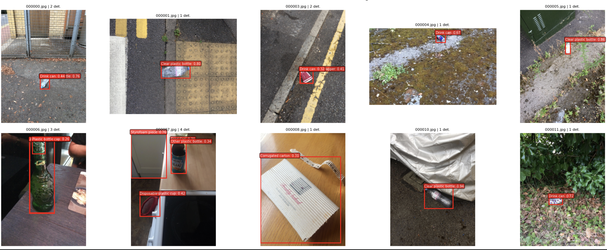
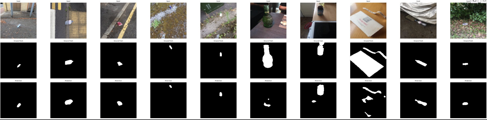
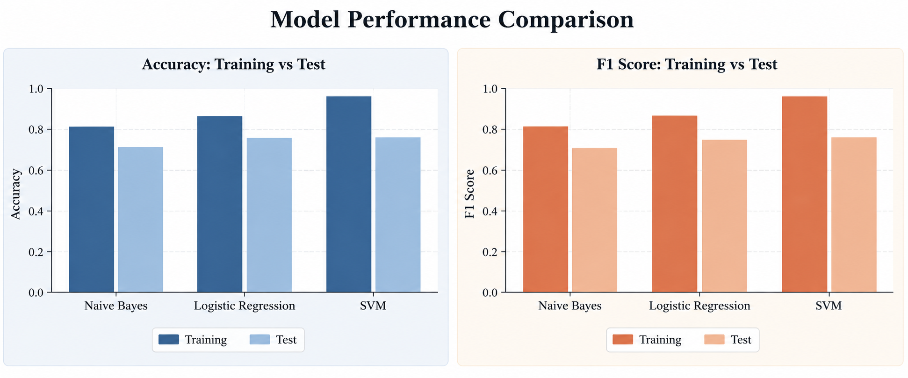
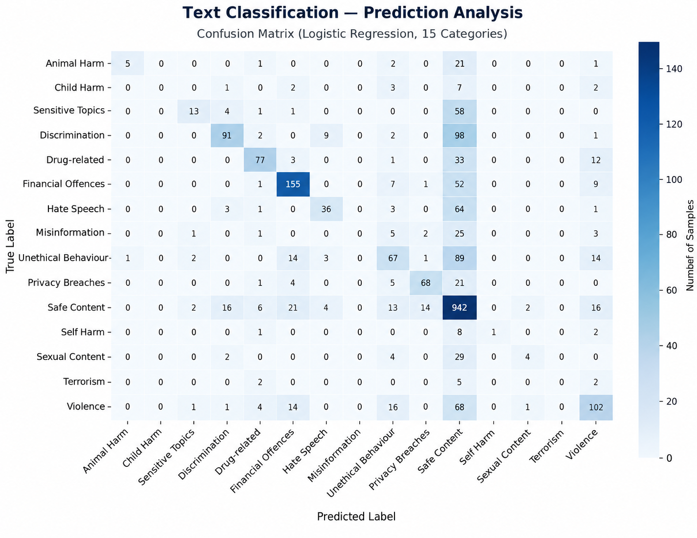

## Coursework Projects

### 1. Computer Vision — Object Detection & Image Segmentation

**Course:** Deep Learning

**Technologies:** Python, PyTorch, YOLOv8n, U-Net, ResNet18, OpenCV

### Project Overview

This project explores object detection and image segmentation using deep learning. I trained and fine-tuned YOLOv8n for object detection and implemented U-Net with a ResNet18 encoder for image segmentation.

For the final task, I used the TACO (Trash Annotations in Context) dataset to detect and segment litter in real-world images.

### 1. Object Detection — YOLOv8n

I trained YOLOv8n on the TACO dataset to identify different types of litter, including plastic bottles, drink cans, and cardboard.

The model predicts bounding boxes, object categories, and confidence scores.

### 2. Image Segmentation — U-Net

I implemented U-Net with a pretrained ResNet18 encoder to segment litter objects from the background.

Unlike object detection, which identifies objects using bounding boxes, segmentation predicts the pixels belonging to each object.

### Challenges and Lessons Learned

The models were able to identify some litter objects, but performance was limited, particularly for small objects and complex backgrounds.

This project helped me understand transfer learning, model evaluation, and the challenges of applying computer vision to real-world images.

### 2. Natural Language Processing — Text Classification

**Course:** Natural Language Processing

**Technologies:** Python, Scikit-learn, TF-IDF,
Naive Bayes, Logistic Regression, Linear SVM

### Project Overview

This coursework project explores text classification
using machine learning. I trained and compared
different models to classify text as Safe or Unsafe,
and also explored classification into 15 categories.

### Model Performance Comparison

I compared Naive Bayes, Logistic Regression and
Linear SVM using training and test accuracy and
F1-score. Linear SVM achieved the highest test
accuracy, although its larger training–test gap
suggested possible overfitting.

### Exploring Model Predictions

I also used Logistic Regression to classify text
into 15 categories. The confusion matrix shows
that the model correctly identified many Safe
examples but struggled with some unsafe categories.

### 3. Front-End Development
**Technologies:** Next.js, React, JavaScript, Tailwind CSS

- Developed interactive features for the Catalyst Fund website.
- Improved user experience through responsive design and front-end development.
  
